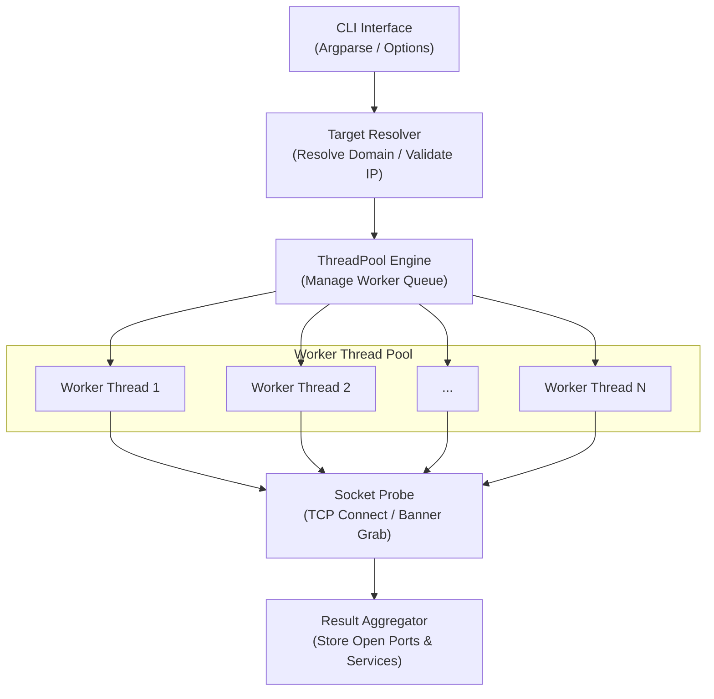

# PortScanner 🔍⚡

A fast, modular, multi-threaded TCP port scanner and service detection engine built in Python, engineered precisely according to the architecture design flow.

---

## 📐 System Architecture

The port scanner is structured into modular layers mirroring the architecture diagram:



### Module Breakdown

| Module | Component | Responsibility |
|---|---|---|
| [`scanner.py`](scanner.py) | **Entrypoint** | Orchestrates the entire pipeline from CLI args to report rendering. |
| [`portscanner/cli.py`](portscanner/cli.py) | **CLI Interface** | Handles argument parsing, port range formatting, and help banner. |
| [`portscanner/target_resolver.py`](portscanner/target_resolver.py) | **Target Resolver** | Validates IPv4/IPv6, resolves domain names to IPs, and performs reverse DNS lookups. |
| [`portscanner/engine.py`](portscanner/engine.py) | **ThreadPool Engine** | Synchronized worker queue, thread lifecycle management, dynamic progress bar, and graceful `Ctrl+C` interrupt handling. |
| [`portscanner/probe.py`](portscanner/probe.py) | **Socket Probe** | Fast non-blocking TCP connect probes, latency timing, TLS handshake analysis, and banner grabbing (SSH, HTTP headers, FTP, SMTP, Redis). |
| [`portscanner/services.py`](portscanner/services.py) | **Service Registry** | Top 100 ports list and comprehensive service signature mapping. |
| [`portscanner/aggregator.py`](portscanner/aggregator.py) | **Result Aggregator** | Thread-safe results collector, real-time open port notifications, tabular terminal reports, and JSON/TXT exporting. |

---

## 🚀 Getting Started

### Prerequisites
- Python 3.8+ (Zero third-party dependencies required; uses Python standard library).

### Quick Start

#### 1. Command-Line Interface (CLI)
```bash
# Basic scan: Scan top 100 ports on a target
python scanner.py scanme.nmap.org

# Scan specific ports
python scanner.py 192.168.1.1 -p 21,22,80,443,8080

# Scan a port range
python scanner.py 10.0.0.1 -p 1-1024

# Scan top 50 ports with 150 threads and export results
python scanner.py scanme.nmap.org --top-ports 50 -t 150 -oJ results.json -oN results.txt
```

#### 2. Graphical User Interface (Desktop GUI)
Launch the dark-themed desktop application:
```bash
python scanner.py --ui
# or
python gui.py
```
- Real-time live open port table updates.
- Target host input, port presets, concurrency slider, and service detection toggles.
- One-click export to JSON or Text file.

#### 3. Web Dashboard UI (Browser)
Launch the browser-based dashboard:
```bash
python scanner.py --web
# or
python web_ui.py
```
- Opens an interactive dashboard at `http://127.0.0.1:5000`.
- Real-time animated progress bar and metrics cards.
- Live port filtering and search.
- Downloadable JSON and TXT reports.

---

## ⚙️ Command-Line Options

```
usage: PortScanner [-h] [-p PORTS] [--top-ports TOP_PORTS] [-t THREADS]
                   [-w TIMEOUT] [-b] [--no-banner] [-oJ FILE] [-oN FILE] [-v]
                   [--no-color] [--no-progress]
                   [target]

positional arguments:
  target                Target IP address or domain name (e.g. 192.168.1.1 or scanme.nmap.org)

options:
  -h, --help            Show this help message and exit
  -p, --ports PORTS     Port(s) to scan: '80', '21,22,80', '1-1024', or 'all' (1-65535)
  --top-ports N         Scan top N common ports (e.g. 50, 100)
  -t, --threads N       Number of concurrent worker threads (default: 100)
  -w, --timeout SECS    Socket timeout per probe in seconds (default: 1.0)
  -b, --banner          Enable service banner grabbing & fingerprinting (default: True)
  --no-banner           Disable banner grabbing for faster raw connect scanning
  -oJ FILE, --json FILE Save scan output to a structured JSON file
  -oN FILE, --output FILE Save scan output to a readable text report
  -v, --verbose         Verbose mode (displays closed and filtered ports)
  --no-color            Disable terminal ANSI color highlighting
  --no-progress         Disable interactive progress bar
```

---

## 📊 Sample Output

```
  ____            _   ____                                  
 |  _ \ ___  _ __| |_/ ___|  ___ __ _ _ __  _ __   ___ _ __ 
 | |_) / _ \| '__| __\___ \ / __/ _` | '_ \| '_ \ / _ \ '__|
 |  __/ (_) | |  | |_ ___) | (_| (_| | | | | | | |  __/ |   
 |_|   \___/|_|   \__|____/ \___\__,_|_| |_|_| |_|\___|_|   
          [ Fast Multi-Threaded TCP Port Scanner ]

[*] Resolving target: scanme.nmap.org...
[+] Target resolved successfully: scanme.nmap.org (45.33.32.156)
[*] Starting scan at 2026-11-10 21:15:00 | Ports: 100 | Threads: 100 | Timeout: 1.0s | Service Detection: ON

  [+] Discovered open port 22/tcp on 45.33.32.156 [SSH (Secure Shell)] (12.4ms) -> SSH-2.0-OpenSSH_6.6.1p1 Ubuntu-2ubuntu2.13
  [+] Discovered open port 80/tcp on 45.33.32.156 [HTTP (Web Server)] (11.8ms) -> Server: Apache/2.4.7 (Ubuntu)

================================================================================
PORT SCAN RESULTS: scanme.nmap.org (45.33.32.156)
================================================================================
PORT       STATE    SERVICE                      LATENCY    BANNER / VERSION              
--------------------------------------------------------------------------------
22/tcp     open     SSH (Secure Shell)           12.4ms     SSH-2.0-OpenSSH_6.6.1p1 Ubuntu
80/tcp     open     HTTP (Web Server)            11.8ms     Server: Apache/2.4.7 (Ubuntu) 
--------------------------------------------------------------------------------
Summary: 2 open, 98 closed, 0 filtered | Total ports: 100 | Time elapsed: 1.15s
================================================================================
```

---

## 🧪 Running Unit Tests

Run the included automated test suite:

```bash
python -m unittest discover -s tests
```

